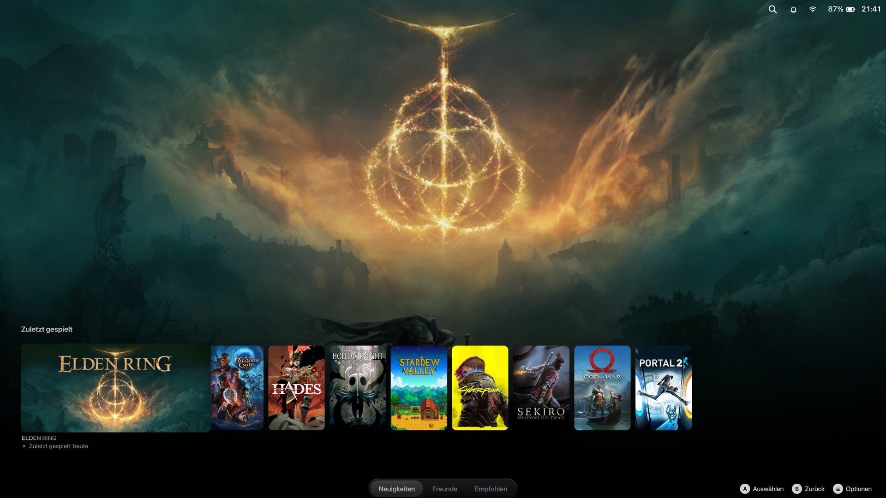
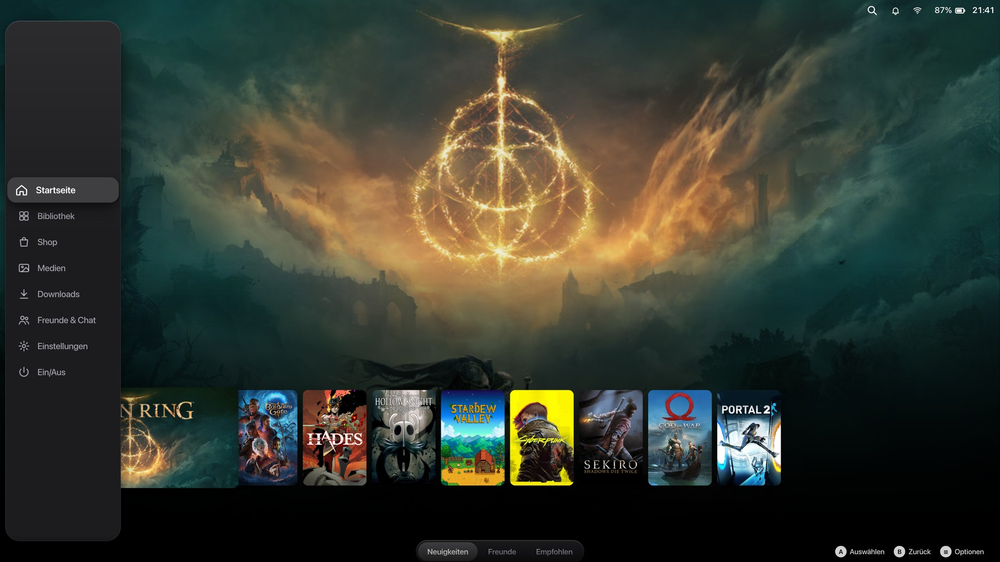
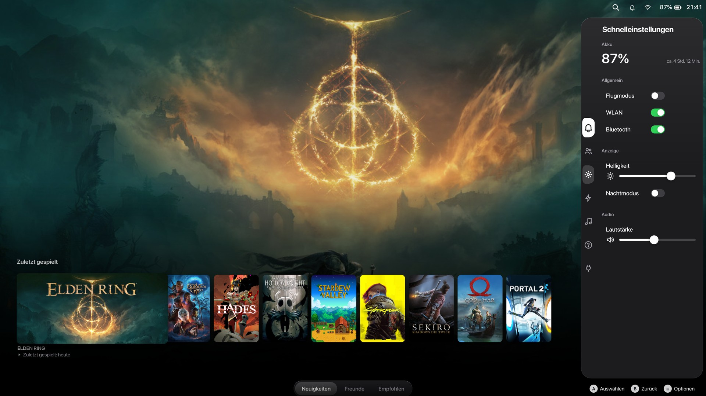
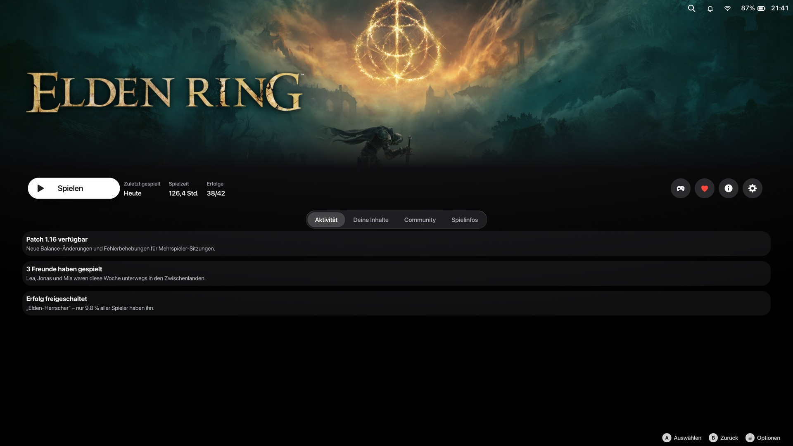
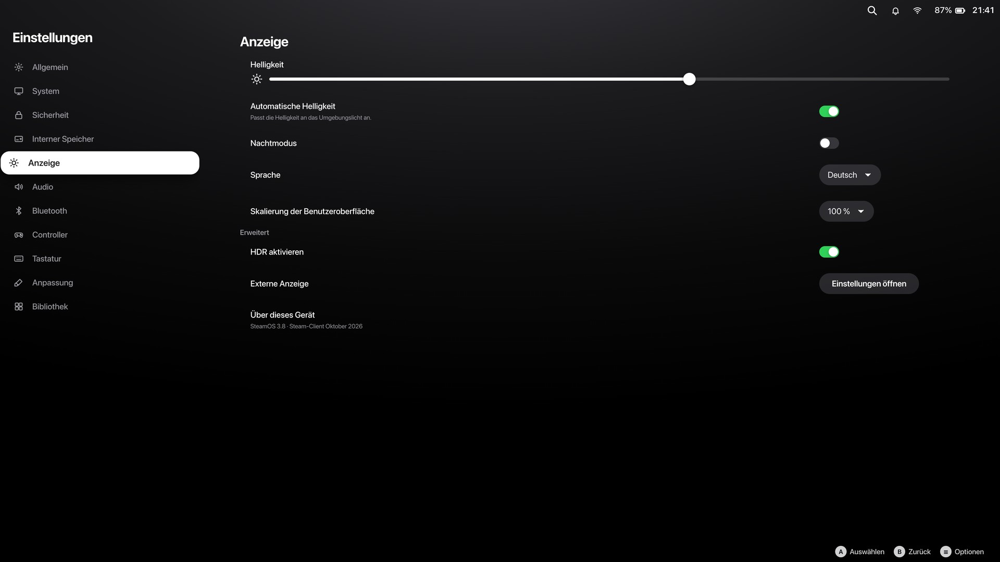
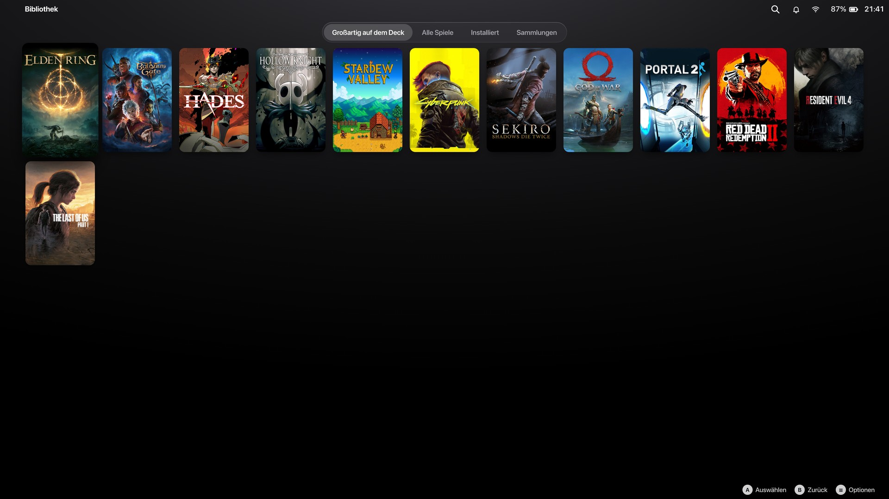
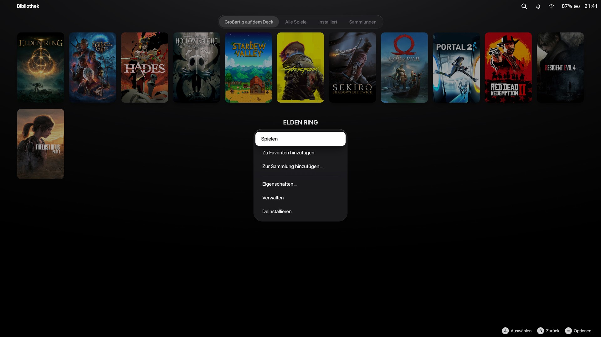

# tvOS Deck

**Apple TV / tvOS look for SteamOS Game Mode** – Steam Machine, Steam Deck and Big Picture.
A theme for [CSS Loader](https://github.com/DeckThemes/SDH-CssLoader) (Decky Loader plugin).



| | |
| --- | --- |
|  |  |
|  |  |
|  |  |

<sub>Rendered with the included preview: Steam's real CSS from the current Steam client plus this theme,
16:9 at 1920 × 1080 logical pixels (4K at 200 %). Full 4K versions are in [`images/4k`](images/4k).</sub>

## Features

- **tvOS focus everywhere** – the focused element turns white with dark text and lifts with a soft shadow.
  No blue outline, no blinking.
- **Game tiles** with rounded corners, focus zoom, a gentle parallax tilt and a moving light glare.
- **Top Shelf home** – bright hero art that fades into the background, game name under the focused tile.
- **Steam menu** as the floating sidebar of the Apple TV app (also the in-game column “Resume, Controller, …”).
- **Quick Access** as a floating Control Center panel.
- **Game page** with a white “Play” button and round glass buttons; **settings** with white focus rows.
- iOS-style toggles, Apple sliders, pill buttons, glass context menus and dialogs, tvOS tab bar,
  tvOS keyboard keys, glass toasts.
- **Font:** Inter (SIL OFL), the closest free match to SF Pro. SF Pro is used automatically if installed.

## Install

**From CSS Loader** (once it is published on DeckThemes): Decky → CSS Loader → *Find themes* → “tvOS Deck”.

**Manually:** download `tvOS-Deck-<version>.zip` from [Releases](../../releases) and extract it into
`~/homebrew/themes/` (you get `~/homebrew/themes/tvOS-Deck`). Then enable it in CSS Loader.

**Recommended Steam setting:** *Settings → Customization → Home → Big Art Mode* – this gives the real
Apple TV Top Shelf layout.

## Steam Machine, 16:9 and 4K

The Steam Machine uses the same Big Picture interface as the Steam Deck; on a 4K TV Steam renders it with display
scaling (for example 200 % = 1920 × 1080 logical pixels). The theme is resolution-independent: no bitmaps, a
variable vector font, layout in relative units, and it is checked at both 1920 × 1080 (16:9) and 1280 × 800
(16:10). On high-DPI screens separators become true 1-pixel hairlines like on tvOS.

## Options

| Option | Values |
| --- | --- |
| Focus Effect | **Apple TV (Parallax)** · Subtle · Off |
| Background | **Graphite** · Black (OLED) · Aurora (tvOS 26) |
| Font | **SF Pro / Inter** · Steam (Motiva Sans) |
| Footer | **Minimal** · Hidden · Steam Default |
| Keyboard Styling | **Yes** · No |
| Reduce Transparency | Yes · **No** – opaque surfaces instead of glass, saves GPU power |
| Colors | Accent color, toggle color |

Steam's *Reduce Motion* setting turns the tile animation off automatically.

## Limitations

- The Steam menu and Quick Access are separate windows on top of the game; they cannot blur what is behind them,
  so they use opaque glass. Dialogs, context menus and tab bars use real background blur.
- Steam renames its CSS classes in updates. CSS Loader translates the class names used here automatically
  (DeckThemes translation service). A few Steam-menu classes are translated wrongly by that service today; the
  theme targets those through `role` attributes and pinned class names instead. The weekly GitHub check reports
  any class that disappears.
- Store and community pages (Valve web pages) are not themed.

## Development

```bash
python3 preview/build_preview.py --serve             # web preview on http://localhost:8765
python3 preview/build_preview.py --refresh --check   # do all theme classes exist in the current Steam build?
python3 preview/build_preview.py --validate          # W3C CSS validation like DeckThemes (needs Java)
python3 preview/build_preview.py --screenshots images  # 16:9 screenshots in 4K and 1080p (needs Chrome)
python3 tools/package_theme.py                       # lint + release/*.zip
```

The preview downloads Steam's current Big Picture package from Valve's CDN once and injects the theme exactly
like CSS Loader does (per Steam window). Arrow keys = D-pad, Enter = A. Releases are built by GitHub Actions
when a tag `v<version>` is pushed; `.github/workflows/check.yml` runs the checks on every push and weekly.

## Credits & license

- Theme code: MIT, see [LICENSE](LICENSE).
- Inter © The Inter Project Authors, SIL Open Font License 1.1 – [`tvOS-Deck/fonts/Inter-OFL.txt`](tvOS-Deck/fonts/Inter-OFL.txt).
- Unofficial fan theme, not affiliated with Apple or Valve. “Apple TV” and “tvOS” are trademarks of Apple Inc.,
  “Steam”, “Steam Deck” and “Steam Machine” are trademarks of Valve Corporation.

---

## Deutsch

Ein CSS-Loader-Theme, das den SteamOS-Spielmodus wie **Apple TV** aussehen lässt – für Steam Machine (16:9, 4K),
Steam Deck und Big Picture. Installation: aus dem Theme-Browser von CSS Loader oder das Release-ZIP nach
`~/homebrew/themes/` entpacken. Empfohlen: *Einstellungen → Anpassung → Startseite → Große Grafik*.
Anleitung zum Veröffentlichen: [docs/VEROEFFENTLICHEN.md](docs/VEROEFFENTLICHEN.md).
